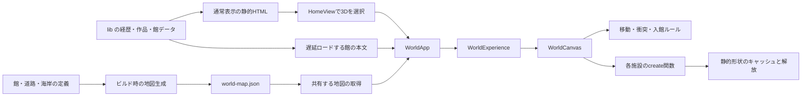

# アーキテクチャと最適化

## 決定

このリポジトリは、Next.js の静的書き出しを使うポートフォリオとして運用する。入口はサーバーでHTMLを生成する通常表示、3Dは必要なときにロードするクライアント機能とする。経歴・作品の事実、館と配置、操作ルールを `lib/` に置き、通常ページと館の表示が同じ定義を参照する。

| 責務 | 実装 | 守ること |
| --- | --- | --- |
| 通常表示 | `app/page.tsx`、`components/ProfilePage.tsx` | JavaScriptや3Dの成功を待たずに本文を読める |
| 表示の選択 | `components/HomeView.tsx`、`components/ModeBar.tsx` | `/?mode=world`・旧 `?detail=…`・記事URL・読書位置を維持する |
| 3Dの読込 | `components/world/WorldApp.tsx`、`lib/world-preload.ts` | 通常表示後の先読みではWebGL・BGMを起動しない |
| 地図の生成 | `app/world-map.json/route.ts`、`lib/world-map-data.ts` | 同じ館・道路データからビルド時に静的JSONを生成する |
| 地図の取得 | `lib/world-map-loader.ts` | 文書内では要求を共有し、新しい文書ではHTTPキャッシュを再検証する。失敗を永久キャッシュしない |
| 館・ツアーの状態 | `components/world/WorldExperience.tsx` | 地図の待機・失敗によって本文閲覧を止めない。地図なしの歩行操作は無効にする |
| 3Dの実行 | `components/world/WorldCanvas.tsx`、`components/world/create-*.ts` | カメラ・入力・描画・資源解放を受け持ち、毎フレームの座標をReactの状態へ送らない |
| 移動の規則 | `lib/world-navigation.ts` など | 衝突・経路・自転車・入館・フォーカスはDOMに依存しない関数で検証する |
| 静的形状の結合 | `components/world/static-geometry.ts` | 共有形状を一度だけインデックス化し、変更用のクローンを返す。結合後に不要な資源を解放する |



## この境界にした理由

以前のトップページは、通常表示に加えて全館の本文と地図をReactのペイロードへ埋め込んでいた。現在は、本文を持つ `WorldApp` のコードと、地図の静的JSONを通常表示後に先読みする。地図の多角形演算をブラウザで再実行することなく、トップHTMLから3D用データを外せる。

地図のJSON化は通信の失敗点を増やすため、館の本文は地図と独立して表示する。待機中でも直接URL・街の案内から本文へ進める。取得失敗時は通常表示へ戻れ、描画なしでツアーの本文を見られる。取得が完了しても、開いていた館をリセットしない。

静的なJSONも `force-static` のGET Route Handlerから書き出すため、実行時サーバーは不要。[Next.jsの静的書き出し](https://nextjs.org/docs/app/guides/static-exports)の範囲で構成している。データベース・状態管理ライブラリ・ECS・常時動作する背景の3Dレンダラーは、この機能には追加しない。

## 形状と資源の扱い

以前は、同じ丸角の箱や円柱を非インデックス形式へ展開し、施設によっては結合後に全頂点を再走査していた。現在は、構築中だけ共有する `createStaticGeometryCache()` がインデックスを持つ形状を返す。同じ元形状は一度だけ処理し、各オブジェクトの変換は独立したクローンへ適用する。クローンは `BufferGeometry.copy()` で作り、箱や円柱のコンストラクターを再実行しない。

元の属性が確定してからキャッシュへ渡す。位置・法線・UV・色・濡れ具合などの属性を区別して頂点を共有し、許容差は `1e-6` とする。三角形は削減しない。透明な部品、複数マテリアルの看板、動く部品の結合範囲は既存の施設ごとの判断を使う。[Three.jsの結合処理](https://threejs.org/docs/pages/module-BufferGeometryUtils.html)に必要な属性の互換性も維持する。

構築用キャッシュは結合後に解放する。街とPCでは、所有するジオメトリのうちシーンから参照されなくなったものも解放する。実行中に必要な形状・共有元・Pointsの形状を誤って解放しないことをテストする。各施設の `dispose()`、人物・物理・レンダラーの終了処理は、それぞれの所有者が引き続き受け持つ。

## 経路探索の準備

静的な経路グリッドを作るときだけ、障害物の拡張AABBを4mの区画へ登録する。各グリッド点は該当区画の候補に対して既存の `isWalkable()` を実行する。通常の衝突関数の意味や、渡した配列の変更に対する挙動は変えない。グリッドの完成結果は従来と同じく障害物配列ごとにキャッシュする。

候補数を減らした後も、実際の島全域と合成した障害物配置の全グリッド点について、元の直接判定との一致を検証する。

## 測定

2026-10-25、ローカルの本番ビルドをChromiumで測定。通常表示後に素材の先読みを待ち、3Dへの切り替えから準備完了までを測った。スマホ相当は390×844、端末DPR 3・描画DPR 2、CPUを4倍低速化。PCは1440×900・端末DPR 2。実機のスマートフォンやSafariの測定値ではない。

| 項目 | 変更前 | 変更後 |
| --- | ---: | ---: |
| トップHTML（未圧縮） | 218,948 B | 30,608 B |
| シーンで使うジオメトリのバッファ合計 | 126,723,616 B | 79,716,256 B |
| スマホ相当の3D準備 | 9,975 ms | 6,664 ms |
| 同条件の最長メインスレッドタスク | 2,872 ms | 1,740 ms |
| スマホ相当・クオリティの描画間隔p95 | 35 ms | 33 ms |

変更前・地図と経路の変更後・形状の変更後を、それぞれ `output/playwright/architecture-before.txt`、`architecture-data-navigation.txt`、`architecture-after.txt` に記録した。表の最終値はクローンの生成を修正後の `output/playwright/architecture-final-performance.txt` に記録している。ローカル環境の単回比較であり、準備時間やFPSの実機保証には使わない。

この最適化はCPU側の生成・転送とバッファ容量を減らす。影・反射を含むクオリティモードのGPU負荷は残る。描画DPR・影・反射・施設・移動速度・地図・保存位置の世代は変更しない。

## 確認方法

```sh
npm test
npm run build
npm run typecheck
npm run security:audit
git diff --check
```

本番書き出しの `out/` をポート3001で配信し、Playwright CLIの `run-code --filename` から次を実行する。

- `tests/browser/architecture-performance.js`: 通常HTML 64KiB以下、ジオメトリ90MiB以下、描画間隔p95 50ms以下。PCとスマホ相当・両画質の実描画を記録する。
- `tests/browser/world-data-loading.js`: 地図が遅い場合と503の場合の館・案内・通常表示への復帰。本文を読む前に地図が必要にならないことを確認する。
- `tests/browser/normal-first.js`: 先読み中の描画・音声停止、読書位置、旧詳細URL、ツアー、戻る・進む、JavaScriptなしの通常表示。
- `tests/browser/world-mode-switch.js`: 表示モード・記事・街の現在地と狭い画面の操作。
- `tests/browser/mobile-resolution.js`: 縦横のDPRと低設定からの復帰。
- `tests/browser/security.js`: 静的ホストのヘッダーを適用した本文・3D・BGM・画質・WASM自転車のCSPと、不正なクエリ・スクリプト・外部通信の遮断。

地図のビルド結果・要求の共有と再試行・全グリッドの一致・形状の属性・所有資源の解放は、通常のNodeテストにも含める。ブラウザ検証・計測の記録は `output/playwright/` に保存し、Web公開とGit管理から除外する。
